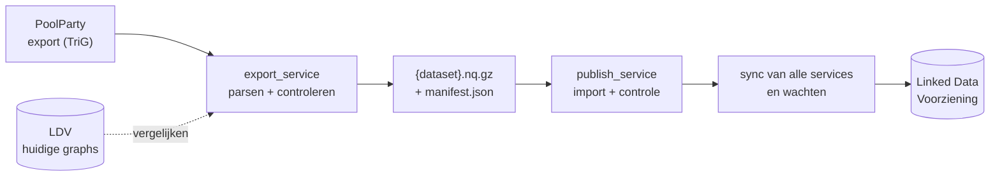

# Thesauri van PoolParty naar de LDV

Exporteert de thesauri van de Rijksdienst voor het Cultureel Erfgoed (RCE) uit **PoolParty**, controleert ze en publiceert ze met
een **GitHub Action** en de **TriplyDB-CLI** in de Linked Data Voorziening (LDV), account
[`thesauri`](https://linkeddata.cultureelerfgoed.nl/thesauri).

## Hoe het werkt



1. **Export.** Elk PoolParty-project wordt één keer per run geëxporteerd (modules `concepts`, `void`, `adms`), ook als het in meer
   datasets staat. Tijdelijke fouten worden opnieuw geprobeerd; een HTML-foutpagina of een lege export wordt herkend.
2. **Controle.** De export moet geldige TriG zijn, de thesaurusgraph uit de configuratie bevatten en concepten hebben. Elke graph
   wordt vergeleken met de LDV: krimpt hij meer dan 10%, dan wordt de dataset niet gepubliceerd.
3. **Bestand per dataset.** De projecten worden omgezet naar N-Quads en per dataset samengevoegd. `manifest.json` legt vast wat er
   is gebeurd, met een checksum per bestand.
4. **Publicatie.** Alleen goedgekeurde datasets worden geïmporteerd (`--mode overwrite`: de graphs in het bestand worden
   vervangen, andere graphs blijven staan). Daarna wordt per graph geteld of de LDV klopt met de export.
5. **Services.** Alle services van de dataset worden gesynchroniseerd; de run wacht tot ze draaien en bij zijn.
6. **Rapport.** Per dataset komt `etl-rapport.json` als asset bij de dataset, onder een vaste naam.

Datasets staan los van elkaar: een fout in één project houdt alleen de datasets met dat project tegen. De run wordt dan wel rood.

## Datasets

De configuratie staat in [`config/config.yml`](config/config.yml).

| Dataset | Projecten |
|---|---|
| `oorlogsbronnen` | WO2-thesaurus, WO2-biografieën (NIOD) |
| `Cultuurhistorische-Thesaurus-CHT` | CHT, Referentienetwerk, ABR |
| `archeologischbasisregister` | ABR versie 2 |
| `referentienetwerk` | Referentienetwerk |
| `cht` | Cultuurhistorische Thesaurus |
| `homosaurus` | Homosaurus (tijdelijk) |
| `onderwerpen-not` | onderwerpenlijst voor het Termennetwerk |
| `rechtenstatus-en-gebruiksrechten` | rechtenstatements |
| `thesauri` | CHT en de WO2-thesauri (testproject van Triply voor Jena) |

## Snel starten (lokaal)

Vereist Python 3.12 of nieuwer.

```bash
python -m venv .venv
source .venv/bin/activate            # Windows: .venv\Scripts\activate
pip install -r requirements.txt
```

```bash
python -m pytest
```

Exporteren en controleren (publiceert niets). In PowerShell zet je de variabele met `$env:POOLPARTY_AUTH = "..."`.

```bash
export POOLPARTY_AUTH='<volledige waarde van de Authorization-header>'
python src/export_service.py --datasets cht
```

Bekijken wat de publicatie zou doen, zonder iets te veranderen:

```bash
python src/publish_service.py --datasets cht --dry-run
```

Meer in [docs/beheer.md](docs/beheer.md).

## GitHub Action

[`.github/workflows/deploy.yml`](.github/workflows/deploy.yml) draait elke dag om **03:00 UTC** en is handmatig te starten met:

| Invoer | Betekenis |
|---|---|
| `datasets` | `all` of een kommagescheiden lijst |
| `publish` | uit = alleen exporteren en controleren |
| `allow_shrink` | sta eenmalig een krimp van meer dan 10% toe |

Jobs: `test` → `export` → `publish`, plus `keepalive`, die de planning actief houdt (zie [docs/beheer.md](docs/beheer.md#planning-actief-houden)). Twee runs lopen nooit tegelijk. De samenvatting van elke run toont per graph het aantal
statements, het verschil met de LDV en de status van de services.

Secrets: `POOLPARTY_AUTH` en `TRIPLYDB_TOKEN`.

## Documentatie

| Document | Inhoud |
|---|---|
| [docs/beheer.md](docs/beheer.md) | een run starten, de uitkomst lezen, foutmeldingen, een project toevoegen, terugdraaien |
| [docs/configuratie.md](docs/configuratie.md) | elke instelling in `config/config.yml` |
| [docs/besluiten.md](docs/besluiten.md) | open punten en de keuzes achter de opzet |
| [CHANGELOG.md](CHANGELOG.md) | wat er wanneer is veranderd |

## Inhoud van de repository

```
.github/workflows/deploy.yml   de workflow
config/config.yml              datasets, projecten en drempels
src/poolparty_client.py        export uit PoolParty (time-out, retries, foutpagina's)
src/ldv_client.py              TriplyDB: graphs en services via de API, import en assets via de CLI
src/export_service.py          export, controles, N-Quads per dataset, manifest
src/publish_service.py         import, controle achteraf, sync, rapport
src/common.py                  configuratie, logging, samenvatting
tests/                         pytest, zonder netwerk
docs/                          documentatie
```

De opzet volgt de andere ETL's van de RCE (bibliotheek, beeldbank, kunstcollecties).

## Licentie en contact

Er is nog geen `LICENSE`-bestand. De andere RCE-ETL's gebruiken GPL-3.0; zie [docs/besluiten.md](docs/besluiten.md).
Voor de thesauri zelf gelden de gebruiksvoorwaarden van de bron.

**Contact:** thesauri@cultureelerfgoed.nl.
